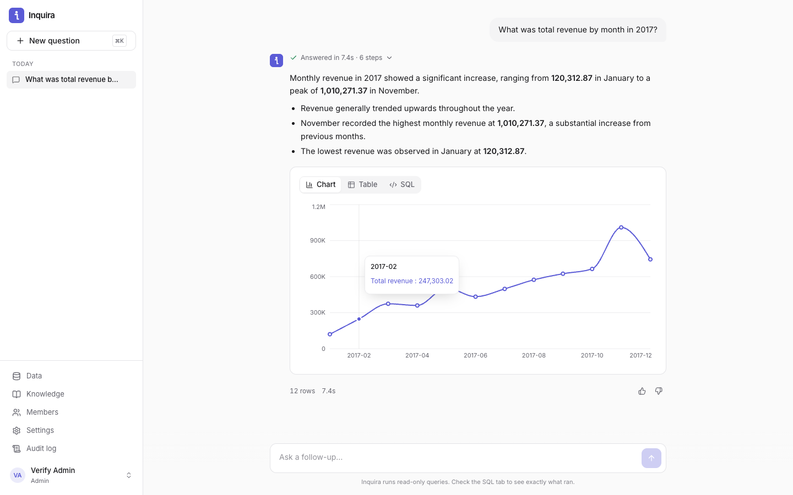

<div align="center">


# Inquira

**Ask your data anything. Get answers you can trust.**

Open-source AI analytics copilot. Ask questions in plain language and get **validated, read-only SQL**,
an instant chart, and a clear answer, streamed live from your own warehouse.

[](https://github.com/UditKaushish/inquira/actions/workflows/ci.yml)
[](LICENSE)


[](CONTRIBUTING.md)

[Quick start](#quick-start) · [Features](#features) · [Architecture](docs/ARCHITECTURE.md) · [Security](SECURITY.md) · [API](docs/API.md)

</div>

---

<p align="center"></p>

> *"Which product categories drove the most revenue last quarter, and how is that trending?"*
>
> Inquira reads your schema, writes the SQL, checks it can't modify anything, runs it, and answers with
> the numbers in bold, a chart, and the exact query, so you can verify every claim.

## Why Inquira

Most text-to-SQL demos stop at "the model wrote some SQL". Inquira is built to sit in front of real data:

- **Safe by construction.** Every model-generated query is parsed into an AST and rejected unless it is a single
  read-only `SELECT` over known tables. Adapters additionally open read-only sessions. No `DROP`, no `COPY`,
  no `read_csv('/etc/passwd')`.
- **Shows its work.** Every answer comes with the SQL, the steps it took, its assumptions, and the raw rows.
- **Self-correcting.** If the database rejects a query, the real error goes back to the model to fix,
  within a bounded number of attempts.
- **Bring your own everything.** Any warehouse, any model, including fully local models via Ollama or vLLM,
  so no data has to leave your network.
- **Two minutes to first answer.** A guided onboarding flow and a bundled 100k-order demo dataset.

## Features

| | |
|---|---|
| **Natural language → SQL** | Dialect-aware generation for DuckDB, PostgreSQL, MySQL, Snowflake, SQLite |
| **Live streaming** | Watch each stage (schema → context → SQL → validate → run → summarise) over SSE |
| **Auto-charts** | Bar, line, pie and KPI tiles, with model suggestions validated against the real result |
| **Conversations** | Follow-ups like *"now only for 2018"* reuse earlier context |
| **Business knowledge** | Teach metric definitions and glossary terms once, and every answer respects them |
| **Multi-model** | Google Gemini, Anthropic Claude, OpenAI, or any OpenAI-compatible endpoint |
| **Team ready** | Admin/member roles, invites, audit log of every question and query, answer feedback |
| **Secure defaults** | argon2id, httpOnly cookies, CSRF protection, rate limits, encrypted credentials at rest |
| **Scales out** | Stateless API, Postgres metadata, Redis rate limits, Docker images, CI |

## Quick start

### Option A: Docker (recommended)

```bash
git clone https://github.com/UditKaushish/inquira.git && cd inquira
cp .env.example .env
echo "INQUIRA_SECRET_KEY=$(python3 -c 'import secrets; print(secrets.token_urlsafe(48))')" >> .env
docker compose up -d --build
```

Open **http://localhost:8080** and follow the onboarding wizard:

1. Create your admin account
2. Pick **Demo dataset** (or connect your own warehouse)
3. Paste an API key ([Gemini has a free tier](https://aistudio.google.com/apikey)), or point at a local Ollama
4. Ask your first question

### Option B: Deploy free on Vercel

1. Fork this repo and import it at [vercel.com/new](https://vercel.com/new). `vercel.json` already defines the
   build, routes, and security headers.
2. In the project, open **Storage → Marketplace** and add **Neon** (Postgres, free tier). It sets `DATABASE_URL`.
   Optionally add **Upstash Redis** for rate limits shared across instances (sets `REDIS_URL`/`KV_URL`).
3. Add an environment variable `INQUIRA_SECRET_KEY` (generate with
   `python3 -c 'import secrets; print(secrets.token_urlsafe(48))'`).
4. Deploy, open your `*.vercel.app` URL, and complete onboarding. Tables are created automatically.

### Option C: Local development

Requires Python 3.11+ (with [uv](https://docs.astral.sh/uv/)) and Node 20+.

```bash
# API → http://127.0.0.1:8000  (docs at /api/docs)
cd backend
uv venv && uv pip install -e ".[dev]"
.venv/bin/uvicorn inquira.main:app --reload

# Web → http://localhost:5173  (in a second terminal)
cd frontend
npm install && npm run dev
```

No database server needed: metadata lives in SQLite under `./var` and the demo warehouse is built into DuckDB
automatically.

## Connect your data

| Source | Install extra | Notes |
|---|---|---|
| Demo (Olist e-commerce) | – | 100k real anonymised orders, 6 tables, built locally in ~2s |
| DuckDB | – | Opened with `read_only=True`, external file access disabled |
| PostgreSQL / Supabase / Neon / Redshift | – (included) | `default_transaction_read_only=on`, statement timeout |
| MySQL / MariaDB / PlanetScale | `inquira[mysql]` | `START TRANSACTION READ ONLY`, `max_execution_time` |
| Snowflake | `inquira[snowflake]` | Statement timeout + query tag. Use a SELECT-only role |
| SQLite | – | Opened with `mode=ro` |

The Docker image includes all drivers. **Always connect with a read-only database user.** Inquira enforces
read-only access in three layers, and your database permissions should be the fourth.

## Models

| Provider | Default model | Notes |
|---|---|---|
| Google Gemini | `gemini-2.5-flash` | Fast, inexpensive, free tier |
| Anthropic | `claude-sonnet-5-5` | Strong reasoning on complex schemas |
| OpenAI | `gpt-4.1-mini` | |
| OpenAI-compatible | `llama3.1:8b` | Ollama, vLLM, LM Studio, Groq, Together, OpenRouter… |

Configure models in the UI, or via `INQUIRA_LLM_PROVIDER` / `INQUIRA_LLM_MODEL` / `INQUIRA_LLM_API_KEY` for GitOps.

## How it works

```
question ─► schema (cached) ─► relevant tables + knowledge (BM25) ─► LLM writes SQL
                                                                         │
            answer + chart ◄─ LLM summarises ◄─ run (read-only) ◄─ AST guard
                                                     ▲                 │
                                                     └── self-repair ◄─┘ on error
```

Read the full design in **[docs/ARCHITECTURE.md](docs/ARCHITECTURE.md)**, and how this project was rebuilt from
an earlier prototype in **[docs/REVERSE_ENGINEERING.md](docs/REVERSE_ENGINEERING.md)**.

## Configuration

All settings are environment variables prefixed with `INQUIRA_`. See [`.env.example`](.env.example).
The important ones:

| Variable | Default | |
|---|---|---|
| `INQUIRA_SECRET_KEY` | auto in dev | **Required in production.** Signs sessions, encrypts stored credentials |
| `INQUIRA_PREVIOUS_SECRET_KEYS` | – | Old keys (comma-separated) still accepted while rotating; then run `python -m inquira rotate-secrets` |
| `INQUIRA_DATABASE_URL` | SQLite in `./var` | Use Postgres in production (`DATABASE_URL` is also accepted) |
| `INQUIRA_REDIS_URL` | – | Shared rate limits across replicas |
| `INQUIRA_MAX_RESULT_ROWS` | `500` | Row cap per query |
| `INQUIRA_QUERY_TIMEOUT_SECONDS` | `30` | Statement timeout |
| `INQUIRA_QUESTION_DEADLINE_SECONDS` | `90` | End-to-end budget per question (all AI calls + query) |
| `INQUIRA_TRUST_PROXY_HEADERS` | `false` | Honour `X-Real-IP`/`X-Forwarded-For`; enable only behind a proxy that overwrites them |

## Project layout

```
backend/    FastAPI service: API, NL→SQL engine, warehouse adapters, tests
frontend/   React + TypeScript + Tailwind single-page app
data/       Bundled demo dataset as Parquet (Olist, CC BY-NC-SA 4.0)
api/        Vercel serverless entry point
docs/       Architecture, data model, API contract, reverse-engineering report
```

## Contributing

Contributions are very welcome, from new warehouse adapters and model providers to UI polish, docs, and
translations. Start with [CONTRIBUTING.md](CONTRIBUTING.md). Good first issues: a BigQuery adapter, a
ClickHouse adapter, an evaluation harness for SQL accuracy.

## Security

Please report vulnerabilities privately. See [SECURITY.md](SECURITY.md).

## License

[Apache License 2.0](LICENSE). The bundled demo data is the
[Olist Brazilian E-Commerce dataset](https://www.kaggle.com/datasets/olistbr/brazilian-ecommerce),
licensed CC BY-NC-SA 4.0 by Olist.
