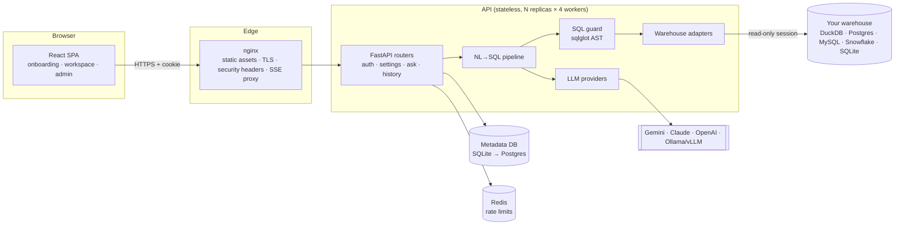
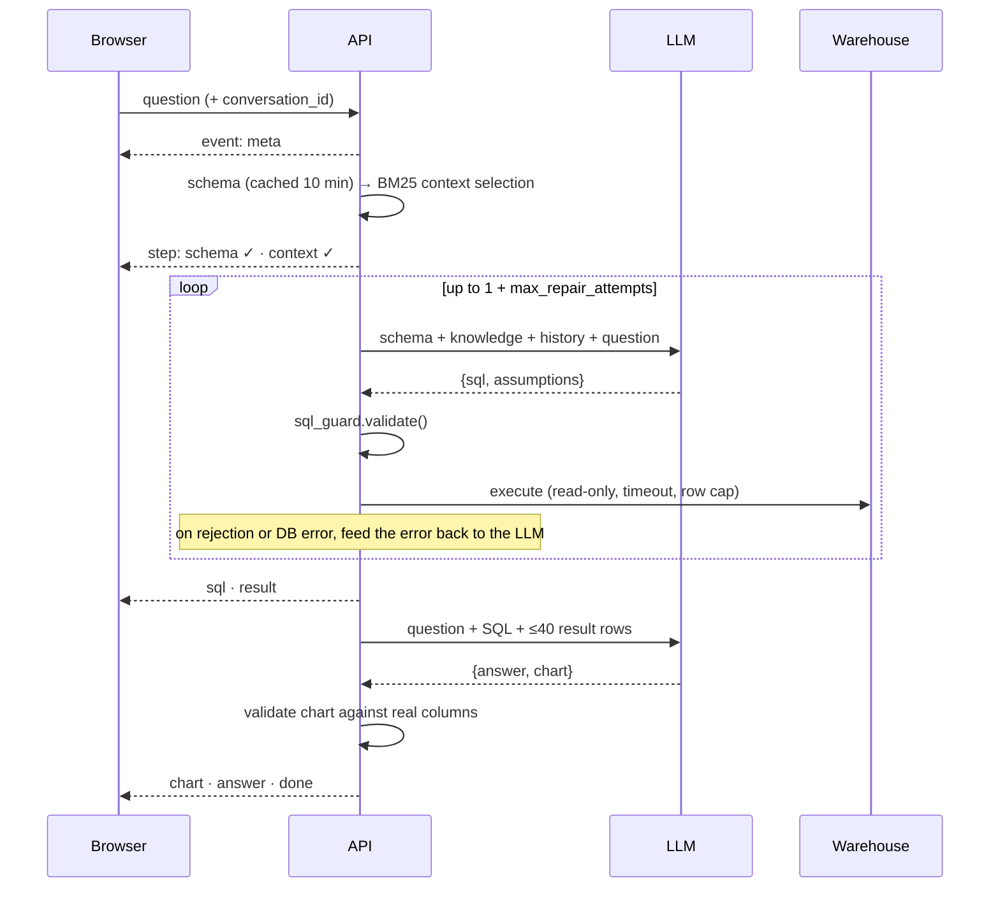

# Architecture

Inquira turns a question in plain language into a **validated, read-only SQL query**, runs it against
your warehouse, and answers with a summary, a chart and the SQL itself, streamed live.

## System overview



## Request lifecycle: `POST /api/v1/ask`



## Codebase map

```
backend/inquira/
├── main.py                 app factory, middleware (request id, CSRF, security headers), error envelope
├── db.py                   SQLAlchemy models: users, app_settings, conversations, messages, knowledge_docs
├── core/
│   ├── config.py           INQUIRA_* settings (pydantic-settings), secret bootstrap
│   ├── security.py         argon2id, session JWT, Fernet encryption of stored secrets
│   ├── ratelimit.py        fixed-window limiter (memory | Redis)
│   └── logging.py          JSON logs with request ids (production)
├── api/                    thin HTTP layer: validation, authZ, serialisation
├── services/settings_store.py  encrypted LLM/datasource settings, warehouse + schema cache
└── engine/                 framework-free core (no FastAPI imports)
    ├── pipeline.py         orchestration, emits events
    ├── context.py          table + knowledge selection (BM25, FK expansion)
    ├── prompts.py          all prompt templates in one reviewable file
    ├── sql_guard.py        AST-level SQL validation
    ├── charts.py           chart inference + validation of model suggestions
    ├── demo.py             builds the bundled DuckDB demo warehouse
    ├── llm/providers.py    Gemini · Anthropic · OpenAI · OpenAI-compatible
    └── warehouse/          adapter contract + DuckDB/Postgres/MySQL/Snowflake/SQLite
frontend/src/               React + TypeScript + Tailwind + TanStack Query
```

## Design decisions

**Two LLM calls, not seven.** The original pipeline chained analyser → intent → IR → refiner → compiler →
reviewer → composer. Each hop added latency and another place to hallucinate. Modern models write
good SQL from a well-rendered schema in one call. We spend the saved budget on a *grounded* repair loop:
real validator and database errors go back to the model.

**Validation over trust.** Model output is treated like user input. `sql_guard` parses SQL with
sqlglot in the warehouse's own dialect and rejects anything that is not a single read query, references
system catalogs or unknown tables, or calls file/network/sleep functions. Adapters *also* open read-only
sessions (`read_only=True`, `default_transaction_read_only`, `START TRANSACTION READ ONLY`), and you should
still grant Inquira a read-only database role. That gives three independent layers.

**Bounded prompts at any scale.** Schemas ≤ 40 tables are sent whole. Larger ones are ranked with BM25 over
table and column names, expanded along foreign keys, and capped at 20 tables. Knowledge notes work the
same way. No vector database is needed to start. The `select_tables` seam is where an embedding
retriever (pgvector, etc.) plugs in.

**Stateless API, horizontal scale.** No in-process state is authoritative. Sessions are signed cookies
validated against a per-user token version in the DB. Rate limits move to Redis with one env var. The
warehouse and schema caches are per-process and keyed by a fingerprint of the stored config, so a settings
change in one replica is picked up by all of them. Long-running work streams over SSE, and nginx is configured
with `proxy_buffering off`.

**Zero-to-value onboarding.** `docker compose up` (or two dev commands) gives you a wizard: create admin →
one-click demo warehouse → paste an API key → ask. Credentials entered in the UI are encrypted with a key
derived from `INQUIRA_SECRET_KEY`. They can be supplied via env instead for GitOps deployments.

**Privacy controls.** Only schema, admin-written knowledge, and at most 40 result rows (for the summary) are
sent to the LLM provider. Point Inquira at a local model through the OpenAI-compatible provider (Ollama,
vLLM) and no data leaves your network.

## Scaling path

| Stage | Setup |
|---|---|
| Laptop | `uvicorn` + Vite, SQLite metadata, DuckDB demo |
| Team | `docker compose up`: nginx + 4 API workers + Postgres + Redis |
| Organisation | Kubernetes: API Deployment with HPA on CPU/RPS, managed Postgres, managed Redis, ingress with TLS. Point `INQUIRA_LLM_*` at a gateway. |

## Roadmap

- Alembic migrations (tables are currently created idempotently on boot)
- SSO (OIDC/SAML) and SCIM provisioning
- Row/column-level access policies per role
- Embedding-based retrieval adapter (pgvector) for very large schemas
- Evaluation harness: golden question → SQL sets per datasource, run in CI
- Query result caching keyed by normalised SQL + datasource fingerprint
- Scheduled questions and Slack/email digests
