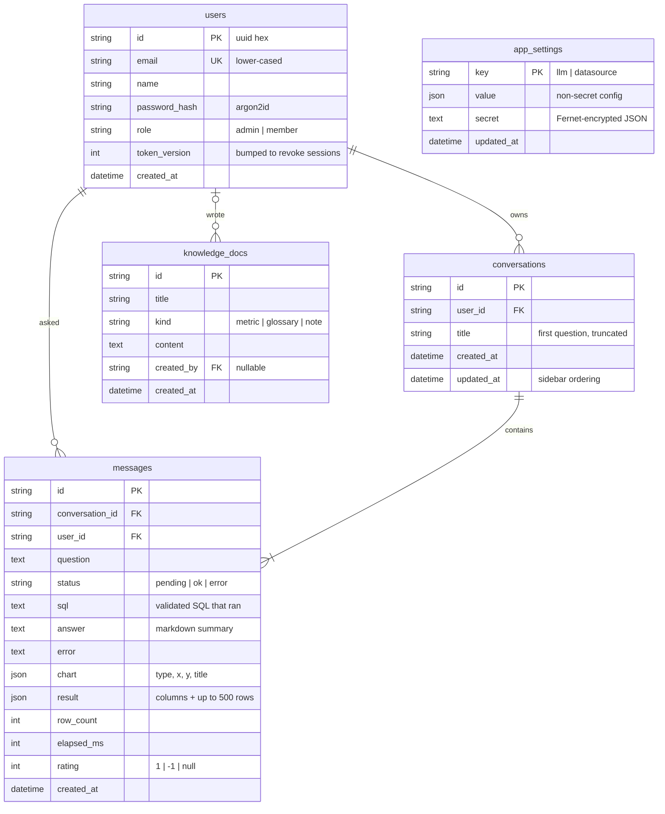

# Data model

Inquira keeps two kinds of data apart:

| Store | What lives there | Who writes it |
|---|---|---|
| **Metadata database** (SQLite locally, Postgres in production) | Users, workspace settings, conversations, answers, knowledge | Inquira |
| **Your warehouse** (DuckDB, Postgres, MySQL, Snowflake, SQLite, or the bundled demo) | Your business data | You. Inquira only ever **reads** it, through read-only sessions |

The schema is versioned with Alembic (`backend/inquira/migrations/`). It upgrades automatically at
startup, or explicitly with `python -m inquira migrate`.

## Entity relationships

## Tables

**`users`**: people who can sign in. The first account is created in onboarding as `admin`; admins
invite `member`s. `token_version` lives in every session token, and incrementing it (logout, role change)
invalidates all of that user's sessions immediately.

**`conversations`**: a thread of questions owned by one user. Users only ever see their own.

**`messages`**: one question and everything Inquira produced for it: the validated SQL, the answer, the
chart spec, a result preview (so history renders without re-querying the warehouse), timing, and the
user's thumbs-up/down. The audit log is a view over this table.

**`knowledge_docs`**: business context written by admins (metric definitions, glossary terms, notes).
Relevant entries are added to the prompt for every question.

**`app_settings`**: workspace configuration as key/value rows. `llm` holds the provider and model, and
`datasource` holds the connection. Anything secret (API keys, database passwords) is stored only in
`secret`, encrypted with a key derived from `INQUIRA_SECRET_KEY` (HKDF + MultiFernet, rotatable), and is
never returned by the API.

## Indexes

| Index | Serves |
|---|---|
| `users.email` (unique) | sign-in |
| `conversations (user_id, updated_at)` | the sidebar: a user's conversations, newest first |
| `messages (conversation_id, created_at)` | opening a conversation in order |
| `messages.created_at` | the audit log |
| `messages.user_id` | per-user queries, cascades |

## Lifecycle and privacy

- Deleting a user cascades to their conversations and messages; their knowledge docs are kept with
  `created_by = NULL`.
- `messages.result` stores a **copy of up to 500 result rows** from your warehouse. Treat the metadata
  database with the same sensitivity as the data users query, back it up, and restrict access.
- The LLM provider receives the schema, relevant knowledge, conversation history (questions and SQL), and at
  most 40 result rows for the summary. Use a local model via the OpenAI-compatible provider to keep
  everything in your network.

## Planned evolution

From the [reliability and scaling roadmap](ARCHITECTURE.md#roadmap), in migration order:

1. **`verified_queries`**: question → SQL pairs promoted from thumbs-up answers, used as few-shot examples.
2. **Column descriptions and sample values** cached per datasource, to improve accuracy on real warehouses.
3. **`usage_events`**: tokens and cost per LLM call, for budgets and model tiering.
4. **Multi-tenancy**: a `workspaces` table, a `workspace_id` on every row, and Postgres row-level security;
   `app_settings` splits into `datasources` and `llm_configs`.
5. **Retention**: configurable expiry for `messages.result` payloads.
